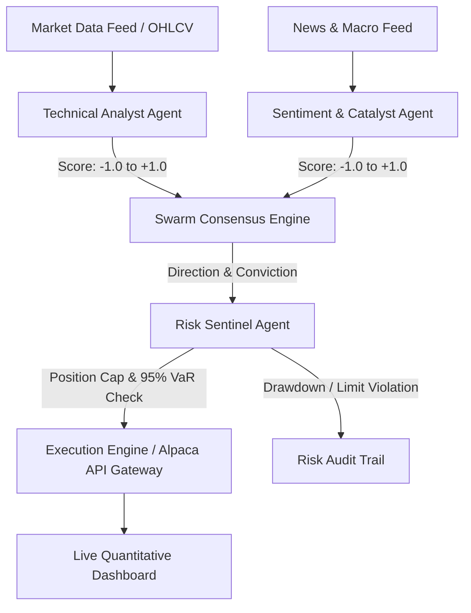

# 🤖 NexusTrade.AI — Alpaca Multi-Agent Autonomous Quantitative Trading Swarm

> **Alpaca AI Trading Agents Hackathon Submission**  
> *Autonomous multi-agent consensus, real-time sentiment analysis, technical indicators, Value at Risk (VaR) sentinel guardrails, and quantitative backtesting.*

---

## 💡 Overview

**NexusTrade.AI** is an institutional-grade autonomous trading and quantitative market research swarm built to empower traders and asset managers with multi-agent consensus reasoning.

Instead of relying on a single model or simple heuristic indicator, **NexusTrade.AI** orchestrates a specialized agent swarm:
1. **📊 Technical Analysis Agent**: Continuously processes price action, calculating real-time RSI, EMA20/50 crossovers, Bollinger Bands, and MACD histograms.
2. **📰 Sentiment & Catalyst Agent**: Evaluates institutional news velocity, earnings reports, and macroeconomic catalysts with probabilistic polarity scoring.
3. **🛡️ Risk Sentinel Agent**: Enforces strict mathematical guardrails—calculating 1-Day 95% Value at Risk (VaR), portfolio position concentration caps (25% max equity), and dynamic trailing stop-losses before any order can be dispatched.
4. **⚡ Execution & Portfolio Engine**: Seamlessly interfaces with Alpaca Trading API endpoints, supporting both paper trading simulation and live order routing with real-time mark-to-market P&L tracking.
5. **📈 Strategy Backtesting Engine**: Performs historical simulation and calculates CAGR, Sharpe Ratio, Max Drawdown, Win Rate, and Profit Factor against benchmark market returns.

---

## 🏛️ Architecture & Agent Flow



---

## 🚀 Key Features

- **Multi-Factor Swarm Deliberation**: Real-time agent debate transcript displayed directly in the dashboard.
- **Glassmorphism Financial Terminal**: Dark UI featuring custom high-resolution HTML5 Canvas candlestick and strategy curve renderers.
- **Circuit Breaker Risk Controls**: Automatic rejection of orders that exceed portfolio cash, position concentration limits, or VaR thresholds.
- **Instant Backtesting**: Run historical Monte Carlo and strategy simulations with visual alpha overlays.

---

## 🛠️ Tech Stack

- **Backend**: Python 3.13, FastAPI, Uvicorn, NumPy, Pandas, Pydantic
- **Frontend**: HTML5 Canvas, Vanilla CSS (Glassmorphic Theme), JavaScript (ES6+)
- **Testing & Verification**: Pytest, Chrome DevTools Browser Automation

---

## 📦 Installation & Quickstart

### 1. Clone the Repository
```bash
git clone https://github.com/sundeep8967/nexustrade-ai.git
cd nexustrade-ai
```

### 2. Install Dependencies
```bash
pip install fastapi uvicorn websockets pydantic requests numpy pandas pytest
```

### 3. Run the Server
```bash
PYTHONPATH=backend python3 -m uvicorn main:app --host 127.0.0.1 --port 8765
```

### 4. Open the Quantitative Terminal
Open your browser and navigate to:
```
http://localhost:8765
```

---

## 🧪 Running Tests

Execute the automated test suite:
```bash
PYTHONPATH=backend pytest tests/
```
